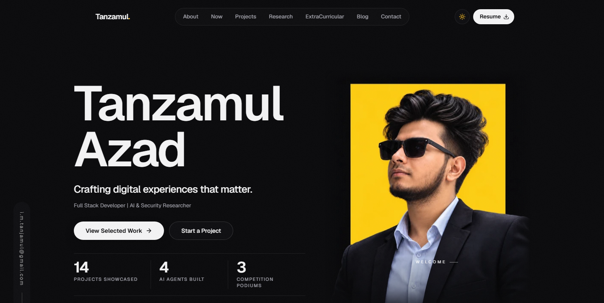

<div align="center">

# Tanzamul Azad — Portfolio

**Generative AI Researcher · Full-Stack Developer**

[](https://tanzamul.dev)
[](https://nextjs.org)
[](https://react.dev)
[](https://www.typescriptlang.org)
[](https://tailwindcss.com)

[](#performance-and-quality)



</div>

My personal portfolio: selected projects with case studies, research, hackathon and competition activity, a blog, and an "Ask AI about me" assistant. Live at **[tanzamul.dev](https://tanzamul.dev)**.

## Highlights

- **Project case studies.** 14 projects, each with problem, solution, architecture and outcome (for example RadFlow, Dawat, UniShare, Complete Legal Aid, PolarWindow).
- **Ask AI about me.** A chat assistant that answers questions about my work, backed by the site's own content.
- **Live GitHub activity.** Contribution data pulled from the GitHub API at build and run time.
- **Blog and research.** Long-form articles with RSS, plus a research section.
- **Content as data.** Copy and lists live in `src/content/*.json`, editable through a local-only admin UI (`/admin`), so no code change is needed to update the site.
- **Opt-in analytics.** GA4 and Web Vitals only run after explicit consent, with a privacy page.
- **Fast by default.** Prebuilt responsive WebP images, precompressed static assets and immutable caching.
- **SEO-ready.** Structured data, sitemap with images, canonical URLs, `llms.txt` and an automated SEO check in CI.
- **Accessible.** Light and dark themes, reduced-motion support, keyboard navigation, WCAG-checked labels.

## Tech stack

| Area | Tools |
| --- | --- |
| Framework | Next.js 16 (App Router, React Compiler), React 19 |
| Language | TypeScript |
| Styling | Tailwind CSS 4 with a token-based design system |
| Motion and UI | Framer Motion, Radix UI, Lucide, Sonner |
| Forms | React Hook Form, Zod |
| Email | Resend (contact form) |
| Images | sharp (build-time responsive WebP pipeline) |
| Hosting | Docker + Nginx on a Google Cloud VM |
| CI/CD | GitHub Actions: lint, typecheck, tests, build, deploy on push to `main` |

## Project structure

```
src/
├── app/            # Routes: home, projects, blog, archive, privacy, API routes, admin
├── components/     # Layout, sections, common and UI primitives
├── config/         # Site metadata and navigation
├── content/        # JSON content (hero, about, projects, research, blog, ...)
├── data/           # Static data helpers
├── lib/            # Utilities, validation, animation variants
└── types/          # Shared TypeScript types
scripts/            # Image pipeline, SEO / telemetry / delivery checks, deploy script
ops/                # Nginx config, CI deploy script, legacy-URL redirect
docs/               # Admin guide, deployment log, SEO audit, design notes
cv/                 # LaTeX source of my CV
```

## Getting started

Requires Node.js 22 (matches CI) and npm.

```bash
git clone https://github.com/Tanjamul-Azad/Portfolio.git
cd Portfolio
npm install
cp .env.example .env.local   # fill in the keys you need
npm run dev
```

Open [http://localhost:3000](http://localhost:3000).

### Environment variables

Everything is optional for a basic run; features degrade gracefully when a key is missing. See [.env.example](.env.example) for the full list.

| Variable | Used for |
| --- | --- |
| `RESEND_API_KEY`, `RESEND_FROM_EMAIL` | Contact form email |
| `GROQ_API_KEY`, `GEMINI_API_KEY`, `DEEPSEEK_API_KEY`, `GLM_API_KEY` | "Ask AI about me" providers |
| `GITHUB_TOKEN`, `GITHUB_OWNER`, `GITHUB_REPO` | Live GitHub activity |
| `ADMIN_PASSWORD`, `ADMIN_SESSION_SECRET` | Local `/admin` content editor |

## Editing content

Most of the site is driven by `src/content/*.json`. Run the dev server and open `/admin` to edit hero, about, projects, research, experience, achievements and blog through forms. The admin is disabled on the live site. See [docs/ADMIN.md](docs/ADMIN.md).

Design tokens (colors, surfaces, spacing, type) live in `src/app/globals.css`; use the token utilities (`bg-surface`, `border-line`, `text-muted-foreground`, `text-accent`) instead of raw color shades.

## Scripts

```bash
npm run dev          # Dev server (prepares images first)
npm run build        # Production build
npm run start        # Serve the production build
npm run lint         # ESLint
npm run typecheck    # TypeScript check
npm run quality      # lint + typecheck + build
npm run images:check # Validate the responsive image set
```

## Performance and quality

The latest live Lighthouse audit (October 2026) scored 100 for Accessibility, Best Practices and SEO. Every deployment passes an SEO check (25 public pages) and an image-delivery check (140+ image URLs) before traffic is switched.

## Deployment

Every push to `main` runs checks, builds the production image on GitHub's runner, streams it to the VM, and swaps it in behind Nginx only if the gates pass. Previous containers are kept for instant rollback. Details: [docs/DEPLOYMENT.md](docs/DEPLOYMENT.md).

## Docs

Design and engineering notes live in [`docs/`](docs): [deployment log](docs/DEPLOYMENT.md), [admin guide](docs/ADMIN.md), [SEO audit](docs/SEO-AUDIT-2026-10-22.md), [analytics](docs/ANALYTICS.md), [image delivery](docs/IMAGE-DELIVERY.md).

## Contact

- Website: [tanzamul.dev](https://tanzamul.dev)
- LinkedIn: [tanjamul-azad](https://linkedin.com/in/tanjamul-azad)
- Email: [i.m.tanjamul@gmail.com](mailto:i.m.tanjamul@gmail.com)

## License

The code is shared for reference and inspiration. The text, images, CV and personal content are © Tanzamul Azad and are not licensed for reuse.
